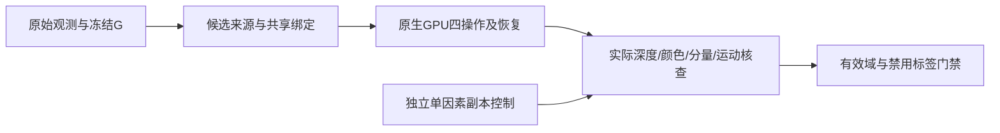

# V43 R4 五例 GPU 与机制核对

这是2026-11-01实际执行脚本的冻结快照。主要对象是008/a37、212/a0、212/a35、564/a0、564/a22，来自3个已见真实场景祖先；另有1个既有程序化世界的独立E1副本控制。新增训练更新和训练标签均为0。

脚本含本次AutoDL物理路径，原始bundle、完整FP32与inference_state保留在 `/root/autodl-tmp/drivingeditor_repro/campaign/v43_ownership_20261028/r4_fivecase_gpu_20261101_r1`。它们是as-run复现入口，迁移环境须显式适配ROOT和来源路径。不要同时启动多个历史控制器；后期队列全局最多2个GPU进程。历史多控制器重叠造成一次OOM，失败及精确恢复分别记账。

主要顺序：`collect_inputs.py` 导出已存在传感器观测；`prepare_five.py` 使用motionproj CPU环境冻结初始域；`run_five.py` 在drivingeditor环境实际audit/smoke/enumerate/sequence；`prepare_fullsource.py` 根据实际原生来源贡献冻结完整来源域。`mechanism_gpu.py`/`mechanisms_real.py` 执行真实机制证据核对，`sim_factor_controls.py` 是独立E1控制，不能混入主要H0方法或维修结果。`summarize_five.py`与交付脚本只读浮点结果，不选择事后最优路由。

保存/恢复是完整推理状态及原始optimizer/tensor bundle的核验引用，不等于新增训练或训练恢复smoke。共享route先生成实际none场景，再执行q；原有静态/动态参数、颜色、opacity、数量和环境保持冻结。008的目标动态行只有合法贡献的暂定关联，未获得真实owner。

机制40条记录不是40项隔离完成。平均深度非首交面，跨域贡献不等于独立多表面，稀疏历史地面见证不是稠密道路GT。9项单因素不变性核验通过不等于已验证全部评价规则。第6/7/8及完整新面等控制仍缺，所有归属训练标签区域禁用。严格FP32伴随总量失败保留，未放宽门禁冒称通过。

Git保留报告、源码、指标、轻量浏览副本和收据，不纳入大模型、原始TFRecord或完整FP32。原始浮点仍是评价输入；JPEG/H264仅供浏览。
